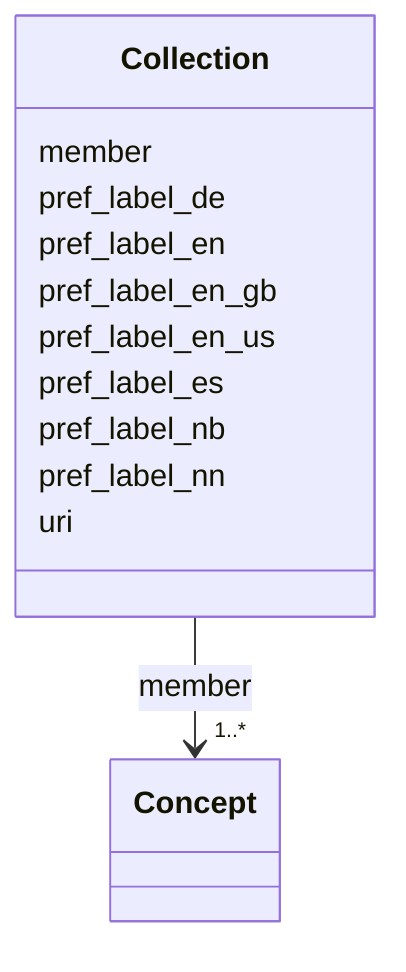

---
search:
  boost: 10.0
---

# Class: Collection 


_A group of concepts, recorded in the main-language scope note of each member ("Inngår i samlingen X." / "Inngår i samlingene X, Y."). There is no Excel row for the collection itself. URI <scheme URI>/samling/<CamelCase name>; the label is the name as written. Unordered and not nested._


<div data-search-exclude markdown="1">


URI: [skos:Collection](http://www.w3.org/2004/02/skos/core#Collection)





<!-- no inheritance hierarchy -->

## Class Properties

| Property | Value |
| --- | --- |
| Class URI | [skos:Collection](http://www.w3.org/2004/02/skos/core#Collection) |


## Slots

| Name | Cardinality and Range | Description | Inheritance |
| ---  | --- | --- | --- |
| [uri](uri.md) | 1 <br/> [uri](uri.md) | Concept or scheme URI | direct |
| [pref_label_nb](pref_label_nb.md) | 0..1 <br/> [String](String.md) | Recommended term, bokmål | direct |
| [pref_label_en](pref_label_en.md) | 0..1 <br/> [String](String.md) |  | direct |
| [pref_label_nn](pref_label_nn.md) | 0..1 <br/> [String](String.md) | Obligatory in the template, but left empty by extraction for the expert (S06) | direct |
| [pref_label_en_us](pref_label_en_us.md) | 0..1 <br/> [String](String.md) |  | direct |
| [pref_label_en_gb](pref_label_en_gb.md) | 0..1 <br/> [String](String.md) |  | direct |
| [pref_label_de](pref_label_de.md) | 0..1 <br/> [String](String.md) |  | direct |
| [pref_label_es](pref_label_es.md) | 0..1 <br/> [String](String.md) |  | direct |
| [member](member.md) | 1..* <br/> [Concept](Concept.md) | Concepts whose main-language scope note names the collection | direct |


## Usages

| used by | used in | type | used |
| ---  | --- | --- | --- |
| [ConceptScheme](ConceptScheme.md) | [collections](collections.md) | range | [Collection](Collection.md) |


## Identifier and Mapping Information


### Schema Source


* from schema: http://example.org/vegvesen/vokabular/def/schema


## Mappings

| Mapping Type | Mapped Value |
| ---  | ---  |
| self | skos:Collection |
| native | svv:Collection |


## LinkML Source

<!-- TODO: investigate https://stackoverflow.com/questions/37606292/how-to-create-tabbed-code-blocks-in-mkdocs-or-sphinx -->

### Direct

<details>
```yaml
name: Collection
description: A group of concepts, recorded in the main-language scope note of each
  member ("Inngår i samlingen X." / "Inngår i samlingene X, Y."). There is no Excel
  row for the collection itself. URI <scheme URI>/samling/<CamelCase name>; the label
  is the name as written. Unordered and not nested.
from_schema: http://example.org/vegvesen/vokabular/def/schema
slots:
- uri
- pref_label_nb
- pref_label_en
- pref_label_nn
- pref_label_en_us
- pref_label_en_gb
- pref_label_de
- pref_label_es
- member
class_uri: skos:Collection

```
</details>

### Induced

<details>
```yaml
name: Collection
description: A group of concepts, recorded in the main-language scope note of each
  member ("Inngår i samlingen X." / "Inngår i samlingene X, Y."). There is no Excel
  row for the collection itself. URI <scheme URI>/samling/<CamelCase name>; the label
  is the name as written. Unordered and not nested.
from_schema: http://example.org/vegvesen/vokabular/def/schema
attributes:
  uri:
    name: uri
    annotations:
      excel_column:
        tag: excel_column
        value: B
      excel_name:
        tag: excel_name
        value: begrep
      excel_value:
        tag: excel_value
        value: CamelCase concept name only
    description: 'Concept or scheme URI. For concepts: <scheme URI>/<concept name>,
      where column B of the workbook holds only the CamelCase concept name (e.g. Rekkverk)
      and the tools build the URI.'
    from_schema: http://example.org/vegvesen/vokabular/def/schema
    rank: 1000
    identifier: true
    owner: Collection
    domain_of:
    - ConceptScheme
    - Concept
    - Collection
    range: uri
    required: true
  pref_label_nb:
    name: pref_label_nb
    annotations:
      excel_column:
        tag: excel_column
        value: C
      excel_name:
        tag: excel_name
        value: anbefalt_term_bokmål
      requirement:
        tag: requirement
        value: obligatorisk
    description: Recommended term, bokmål. Lowercase except acronyms (S05). Required
      when the main language is nb (SHACL rule).
    from_schema: http://example.org/vegvesen/vokabular/def/schema
    in_language: nb
    rank: 1000
    slot_uri: skos:prefLabel
    owner: Collection
    domain_of:
    - Concept
    - Collection
    range: string
  pref_label_en:
    name: pref_label_en
    annotations:
      excel_column:
        tag: excel_column
        value: D
      excel_name:
        tag: excel_name
        value: anbefalt_term_engelsk
      requirement:
        tag: requirement
        value: valgfri
    from_schema: http://example.org/vegvesen/vokabular/def/schema
    in_language: en
    rank: 1000
    slot_uri: skos:prefLabel
    owner: Collection
    domain_of:
    - Concept
    - Collection
    range: string
  pref_label_nn:
    name: pref_label_nn
    annotations:
      excel_column:
        tag: excel_column
        value: E
      excel_name:
        tag: excel_name
        value: anbefalt_term_nynorsk
      requirement:
        tag: requirement
        value: obligatorisk
    description: Obligatory in the template, but left empty by extraction for the
      expert (S06).
    from_schema: http://example.org/vegvesen/vokabular/def/schema
    in_language: nn
    rank: 1000
    slot_uri: skos:prefLabel
    owner: Collection
    domain_of:
    - Concept
    - Collection
    range: string
  pref_label_en_us:
    name: pref_label_en_us
    annotations:
      excel_column:
        tag: excel_column
        value: AN
      excel_name:
        tag: excel_name
        value: anbefalt_term_engelsk_us
      requirement:
        tag: requirement
        value: valgfri
      template:
        tag: template
        value: v8-lang-ext
    from_schema: http://example.org/vegvesen/vokabular/def/schema
    in_language: en-US
    rank: 1000
    slot_uri: skos:prefLabel
    owner: Collection
    domain_of:
    - Concept
    - Collection
    range: string
  pref_label_en_gb:
    name: pref_label_en_gb
    annotations:
      excel_column:
        tag: excel_column
        value: AO
      excel_name:
        tag: excel_name
        value: anbefalt_term_engelsk_gb
      requirement:
        tag: requirement
        value: valgfri
      template:
        tag: template
        value: v8-lang-ext
    from_schema: http://example.org/vegvesen/vokabular/def/schema
    in_language: en-GB
    rank: 1000
    slot_uri: skos:prefLabel
    owner: Collection
    domain_of:
    - Concept
    - Collection
    range: string
  pref_label_de:
    name: pref_label_de
    annotations:
      excel_column:
        tag: excel_column
        value: AP
      excel_name:
        tag: excel_name
        value: anbefalt_term_tysk
      requirement:
        tag: requirement
        value: valgfri
      template:
        tag: template
        value: v8-lang-ext
    from_schema: http://example.org/vegvesen/vokabular/def/schema
    in_language: de
    rank: 1000
    slot_uri: skos:prefLabel
    owner: Collection
    domain_of:
    - Concept
    - Collection
    range: string
  pref_label_es:
    name: pref_label_es
    annotations:
      excel_column:
        tag: excel_column
        value: AQ
      excel_name:
        tag: excel_name
        value: anbefalt_term_spansk
      requirement:
        tag: requirement
        value: valgfri
      template:
        tag: template
        value: v8-lang-ext
    from_schema: http://example.org/vegvesen/vokabular/def/schema
    in_language: es
    rank: 1000
    slot_uri: skos:prefLabel
    owner: Collection
    domain_of:
    - Concept
    - Collection
    range: string
  member:
    name: member
    annotations:
      excel_source:
        tag: excel_source
        value: 'scope note sentence: Inngår i samlingen/samlingene …'
    description: Concepts whose main-language scope note names the collection.
    from_schema: http://example.org/vegvesen/vokabular/def/schema
    rank: 1000
    slot_uri: skos:member
    owner: Collection
    domain_of:
    - Collection
    range: Concept
    required: true
    multivalued: true
class_uri: skos:Collection

```
</details></div>