---
search:
  boost: 10.0
---

# Class: Concept 


_One row in the vokabular sheet (row 23 onwards)._


<div data-search-exclude markdown="1">


URI: [skos:Concept](http://www.w3.org/2004/02/skos/core#Concept)

```mermaid
 classDiagram
    class Concept
    click Concept href "../Concept/"
      Concept : alt_label_de
        
      Concept : alt_label_en
        
      Concept : alt_label_en_gb
        
      Concept : alt_label_en_us
        
      Concept : alt_label_es
        
      Concept : alt_label_nb
        
      Concept : alt_label_nn
        
      Concept : audience
        
      Concept : broader
        
          
    
        
        
        Concept --> "*" Concept : broader
        click Concept href "../Concept/"
    

        
      Concept : close_match
        
      Concept : contact_point
        
      Concept : created
        
      Concept : created_by
        
      Concept : data_structure_label
        
      Concept : definition_en
        
      Concept : definition_en_us
        
      Concept : definition_nb
        
      Concept : definition_nn
        
      Concept : editorial_note
        
      Concept : end_date
        
      Concept : exact_match
        
      Concept : example
        
      Concept : hidden_label
        
      Concept : identifier
        
      Concept : in_scheme
        
      Concept : is_part_of
        
          
    
        
        
        Concept --> "*" Concept : is_part_of
        click Concept href "../Concept/"
    

        
      Concept : modified
        
      Concept : modified_by
        
      Concept : notation
        
      Concept : pref_label_de
        
      Concept : pref_label_en
        
      Concept : pref_label_en_gb
        
      Concept : pref_label_en_us
        
      Concept : pref_label_es
        
      Concept : pref_label_nb
        
      Concept : pref_label_nn
        
      Concept : related
        
          
    
        
        
        Concept --> "*" Concept : related
        click Concept href "../Concept/"
    

        
      Concept : relation_role
        
      Concept : relationship_with_source
        
      Concept : scope_note
        
      Concept : scope_note_en_us
        
      Concept : source
        
      Concept : start_date
        
      Concept : status
        
          
    
        
        
        Concept --> "0..1" ConceptStatus : status
        click ConceptStatus href "../ConceptStatus/"
    

        
      Concept : subject
        
      Concept : tier
        
      Concept : uri
        
      Concept : value_range
        
      Concept : version_info
        
      Concept : version_notes
        
      
```





<!-- no inheritance hierarchy -->

## Class Properties

| Property | Value |
| --- | --- |
| Class URI | [skos:Concept](http://www.w3.org/2004/02/skos/core#Concept) |


## Slots

| Name | Cardinality and Range | Description | Inheritance |
| ---  | --- | --- | --- |
| [uri](uri.md) | 1 <br/> [uri](uri.md) | Concept or scheme URI | direct |
| [identifier](identifier.md) | 1 <br/> [String](String.md) | <kortnavn>-<concept name>, e | direct |
| [pref_label_nb](pref_label_nb.md) | 0..1 <br/> [String](String.md) | Recommended term, bokmål | direct |
| [pref_label_en](pref_label_en.md) | 0..1 <br/> [String](String.md) |  | direct |
| [pref_label_nn](pref_label_nn.md) | 0..1 <br/> [String](String.md) | Obligatory in the template, but left empty by extraction for the expert (S06) | direct |
| [notation](notation.md) | 0..1 <br/> [String](String.md) |  | direct |
| [definition_nb](definition_nb.md) | 0..1 <br/> [String](String.md) | Required when the main language is nb (SHACL rule) | direct |
| [definition_en](definition_en.md) | 0..1 <br/> [String](String.md) |  | direct |
| [definition_nn](definition_nn.md) | 0..1 <br/> [String](String.md) |  | direct |
| [alt_label_nb](alt_label_nb.md) | * <br/> [String](String.md) |  | direct |
| [alt_label_en](alt_label_en.md) | * <br/> [String](String.md) |  | direct |
| [alt_label_nn](alt_label_nn.md) | * <br/> [String](String.md) |  | direct |
| [audience](audience.md) | 0..1 <br/> [String](String.md) |  | direct |
| [source](source.md) | 0..1 <br/> [uri](uri.md) |  | direct |
| [relationship_with_source](relationship_with_source.md) | 0..1 <br/> [String](String.md) |  | direct |
| [scope_note](scope_note.md) | 0..1 <br/> [String](String.md) |  | direct |
| [editorial_note](editorial_note.md) | 0..1 <br/> [String](String.md) |  | direct |
| [example](example.md) | 0..1 <br/> [String](String.md) |  | direct |
| [subject](subject.md) | 0..1 <br/> [String](String.md) | Subject area | direct |
| [hidden_label](hidden_label.md) | 0..1 <br/> [String](String.md) | Discouraged term, e | direct |
| [broader](broader.md) | * <br/> [Concept](Concept.md) |  | direct |
| [is_part_of](is_part_of.md) | * <br/> [Concept](Concept.md) |  | direct |
| [related](related.md) | * <br/> [Concept](Concept.md) |  | direct |
| [relation_role](relation_role.md) | 0..1 <br/> [String](String.md) |  | direct |
| [exact_match](exact_match.md) | * <br/> [uri](uri.md) |  | direct |
| [close_match](close_match.md) | * <br/> [uri](uri.md) |  | direct |
| [contact_point](contact_point.md) | 1 <br/> [String](String.md) | E-mail address or web address | direct |
| [created](created.md) | 0..1 <br/> [Date](Date.md) |  | direct |
| [created_by](created_by.md) | 0..1 <br/> [String](String.md) | Hidden column; template formula = dct:creator of the vocabulary (cell B16) | direct |
| [modified](modified.md) | 0..1 <br/> [Date](Date.md) |  | direct |
| [modified_by](modified_by.md) | 0..1 <br/> [String](String.md) |  | direct |
| [version_info](version_info.md) | 0..1 <br/> [String](String.md) |  | direct |
| [version_notes](version_notes.md) | 0..1 <br/> [String](String.md) |  | direct |
| [status](status.md) | 0..1 <br/> [ConceptStatus](ConceptStatus.md) |  | direct |
| [start_date](start_date.md) | 0..1 <br/> [Date](Date.md) |  | direct |
| [end_date](end_date.md) | 0..1 <br/> [Date](Date.md) |  | direct |
| [data_structure_label](data_structure_label.md) | 0..1 <br/> [String](String.md) |  | direct |
| [value_range](value_range.md) | 0..1 <br/> [String](String.md) |  | direct |
| [tier](tier.md) | 0..1 <br/> [Integer](Integer.md) | 1 = physical objects, spatial concepts, measurable properties; 2 = processes ... | direct |
| [pref_label_en_us](pref_label_en_us.md) | 0..1 <br/> [String](String.md) |  | direct |
| [pref_label_en_gb](pref_label_en_gb.md) | 0..1 <br/> [String](String.md) |  | direct |
| [pref_label_de](pref_label_de.md) | 0..1 <br/> [String](String.md) |  | direct |
| [pref_label_es](pref_label_es.md) | 0..1 <br/> [String](String.md) |  | direct |
| [alt_label_en_us](alt_label_en_us.md) | * <br/> [String](String.md) |  | direct |
| [alt_label_en_gb](alt_label_en_gb.md) | * <br/> [String](String.md) |  | direct |
| [alt_label_de](alt_label_de.md) | * <br/> [String](String.md) |  | direct |
| [alt_label_es](alt_label_es.md) | * <br/> [String](String.md) |  | direct |
| [definition_en_us](definition_en_us.md) | 0..1 <br/> [String](String.md) |  | direct |
| [scope_note_en_us](scope_note_en_us.md) | 0..1 <br/> [String](String.md) | Usage note in US English, e | direct |
| [in_scheme](in_scheme.md) | 0..1 <br/> [uri](uri.md) | Set by the converter from the scheme URI | direct |


## Usages

| used by | used in | type | used |
| ---  | --- | --- | --- |
| [ConceptScheme](ConceptScheme.md) | [concepts](concepts.md) | range | [Concept](Concept.md) |
| [Concept](Concept.md) | [broader](broader.md) | range | [Concept](Concept.md) |
| [Concept](Concept.md) | [is_part_of](is_part_of.md) | range | [Concept](Concept.md) |
| [Concept](Concept.md) | [related](related.md) | range | [Concept](Concept.md) |
| [Collection](Collection.md) | [member](member.md) | range | [Concept](Concept.md) |


## Identifier and Mapping Information


### Schema Source


* from schema: http://example.org/vegvesen/vokabular/def/schema


## Mappings

| Mapping Type | Mapped Value |
| ---  | ---  |
| self | skos:Concept |
| native | svv:Concept |


## LinkML Source

<!-- TODO: investigate https://stackoverflow.com/questions/37606292/how-to-create-tabbed-code-blocks-in-mkdocs-or-sphinx -->

### Direct

<details>
```yaml
name: Concept
description: One row in the vokabular sheet (row 23 onwards).
from_schema: http://example.org/vegvesen/vokabular/def/schema
slots:
- uri
- identifier
- pref_label_nb
- pref_label_en
- pref_label_nn
- notation
- definition_nb
- definition_en
- definition_nn
- alt_label_nb
- alt_label_en
- alt_label_nn
- audience
- source
- relationship_with_source
- scope_note
- editorial_note
- example
- subject
- hidden_label
- broader
- is_part_of
- related
- relation_role
- exact_match
- close_match
- contact_point
- created
- created_by
- modified
- modified_by
- version_info
- version_notes
- status
- start_date
- end_date
- data_structure_label
- value_range
- tier
- pref_label_en_us
- pref_label_en_gb
- pref_label_de
- pref_label_es
- alt_label_en_us
- alt_label_en_gb
- alt_label_de
- alt_label_es
- definition_en_us
- scope_note_en_us
- in_scheme
class_uri: skos:Concept

```
</details>

### Induced

<details>
```yaml
name: Concept
description: One row in the vokabular sheet (row 23 onwards).
from_schema: http://example.org/vegvesen/vokabular/def/schema
attributes:
  uri:
    name: uri
    annotations:
      excel_column:
        tag: excel_column
        value: B
      excel_name:
        tag: excel_name
        value: begrep
      excel_value:
        tag: excel_value
        value: CamelCase concept name only
    description: 'Concept or scheme URI. For concepts: <scheme URI>/<concept name>,
      where column B of the workbook holds only the CamelCase concept name (e.g. Rekkverk)
      and the tools build the URI.'
    from_schema: http://example.org/vegvesen/vokabular/def/schema
    rank: 1000
    identifier: true
    owner: Concept
    domain_of:
    - ConceptScheme
    - Concept
    - Collection
    range: uri
    required: true
  identifier:
    name: identifier
    annotations:
      excel_column:
        tag: excel_column
        value: A
      excel_name:
        tag: excel_name
        value: intern_identifikator
      requirement:
        tag: requirement
        value: obligatorisk
    description: <kortnavn>-<concept name>, e.g. N101-Rekkverk (formula in column
      A). Relations in Excel use the concept name.
    from_schema: http://example.org/vegvesen/vokabular/def/schema
    rank: 1000
    slot_uri: dct:identifier
    owner: Concept
    domain_of:
    - Concept
    range: string
    required: true
    pattern: ^[A-Za-z0-9][A-Za-z0-9-]*$
  pref_label_nb:
    name: pref_label_nb
    annotations:
      excel_column:
        tag: excel_column
        value: C
      excel_name:
        tag: excel_name
        value: anbefalt_term_bokmål
      requirement:
        tag: requirement
        value: obligatorisk
    description: Recommended term, bokmål. Lowercase except acronyms (S05). Required
      when the main language is nb (SHACL rule).
    from_schema: http://example.org/vegvesen/vokabular/def/schema
    in_language: nb
    rank: 1000
    slot_uri: skos:prefLabel
    owner: Concept
    domain_of:
    - Concept
    - Collection
    range: string
  pref_label_en:
    name: pref_label_en
    annotations:
      excel_column:
        tag: excel_column
        value: D
      excel_name:
        tag: excel_name
        value: anbefalt_term_engelsk
      requirement:
        tag: requirement
        value: valgfri
    from_schema: http://example.org/vegvesen/vokabular/def/schema
    in_language: en
    rank: 1000
    slot_uri: skos:prefLabel
    owner: Concept
    domain_of:
    - Concept
    - Collection
    range: string
  pref_label_nn:
    name: pref_label_nn
    annotations:
      excel_column:
        tag: excel_column
        value: E
      excel_name:
        tag: excel_name
        value: anbefalt_term_nynorsk
      requirement:
        tag: requirement
        value: obligatorisk
    description: Obligatory in the template, but left empty by extraction for the
      expert (S06).
    from_schema: http://example.org/vegvesen/vokabular/def/schema
    in_language: nn
    rank: 1000
    slot_uri: skos:prefLabel
    owner: Concept
    domain_of:
    - Concept
    - Collection
    range: string
  notation:
    name: notation
    annotations:
      excel_column:
        tag: excel_column
        value: F
      excel_name:
        tag: excel_name
        value: notasjon_eller_kode
      requirement:
        tag: requirement
        value: valgfri
    from_schema: http://example.org/vegvesen/vokabular/def/schema
    rank: 1000
    slot_uri: skos:notation
    owner: Concept
    domain_of:
    - Concept
    range: string
  definition_nb:
    name: definition_nb
    annotations:
      excel_column:
        tag: excel_column
        value: G
      excel_name:
        tag: excel_name
        value: definisjon_bokmål
      requirement:
        tag: requirement
        value: obligatorisk
    description: Required when the main language is nb (SHACL rule).
    from_schema: http://example.org/vegvesen/vokabular/def/schema
    in_language: nb
    rank: 1000
    slot_uri: skos:definition
    owner: Concept
    domain_of:
    - Concept
    range: string
  definition_en:
    name: definition_en
    annotations:
      excel_column:
        tag: excel_column
        value: H
      excel_name:
        tag: excel_name
        value: definisjon_engelsk
      requirement:
        tag: requirement
        value: valgfri
    from_schema: http://example.org/vegvesen/vokabular/def/schema
    in_language: en
    rank: 1000
    slot_uri: skos:definition
    owner: Concept
    domain_of:
    - Concept
    range: string
  definition_nn:
    name: definition_nn
    annotations:
      excel_column:
        tag: excel_column
        value: I
      excel_name:
        tag: excel_name
        value: definisjon_nynorsk
      requirement:
        tag: requirement
        value: obligatorisk
    from_schema: http://example.org/vegvesen/vokabular/def/schema
    in_language: nn
    rank: 1000
    slot_uri: skos:definition
    owner: Concept
    domain_of:
    - Concept
    range: string
  alt_label_nb:
    name: alt_label_nb
    annotations:
      excel_column:
        tag: excel_column
        value: J
      excel_name:
        tag: excel_name
        value: tillat_term_bokmål
      requirement:
        tag: requirement
        value: anbefalt
      separator:
        tag: separator
        value: ','
    from_schema: http://example.org/vegvesen/vokabular/def/schema
    in_language: nb
    rank: 1000
    slot_uri: skos:altLabel
    owner: Concept
    domain_of:
    - Concept
    range: string
    multivalued: true
  alt_label_en:
    name: alt_label_en
    annotations:
      excel_column:
        tag: excel_column
        value: L
      excel_name:
        tag: excel_name
        value: tillat_term_engelsk
      requirement:
        tag: requirement
        value: anbefalt
      separator:
        tag: separator
        value: ','
    from_schema: http://example.org/vegvesen/vokabular/def/schema
    in_language: en
    rank: 1000
    slot_uri: skos:altLabel
    owner: Concept
    domain_of:
    - Concept
    range: string
    multivalued: true
  alt_label_nn:
    name: alt_label_nn
    annotations:
      excel_column:
        tag: excel_column
        value: K
      excel_name:
        tag: excel_name
        value: tillat_term_nynorsk
      requirement:
        tag: requirement
        value: anbefalt
      separator:
        tag: separator
        value: ','
    from_schema: http://example.org/vegvesen/vokabular/def/schema
    in_language: nn
    rank: 1000
    slot_uri: skos:altLabel
    owner: Concept
    domain_of:
    - Concept
    range: string
    multivalued: true
  audience:
    name: audience
    annotations:
      excel_column:
        tag: excel_column
        value: M
      excel_name:
        tag: excel_name
        value: målgruppe
    from_schema: http://example.org/vegvesen/vokabular/def/schema
    rank: 1000
    slot_uri: dct:audience
    owner: Concept
    domain_of:
    - Concept
    range: string
  source:
    name: source
    annotations:
      excel_column:
        tag: excel_column
        value: N
      excel_name:
        tag: excel_name
        value: kilde
      requirement:
        tag: requirement
        value: valgfri
    from_schema: http://example.org/vegvesen/vokabular/def/schema
    rank: 1000
    slot_uri: dct:source
    owner: Concept
    domain_of:
    - Concept
    range: uri
  relationship_with_source:
    name: relationship_with_source
    annotations:
      excel_column:
        tag: excel_column
        value: O
      excel_name:
        tag: excel_name
        value: forhold_til_kilde
    from_schema: http://example.org/vegvesen/vokabular/def/schema
    rank: 1000
    slot_uri: skosno:relationshipWithSource
    owner: Concept
    domain_of:
    - Concept
    range: string
  scope_note:
    name: scope_note
    annotations:
      excel_column:
        tag: excel_column
        value: P
      excel_name:
        tag: excel_name
        value: merknad
      requirement:
        tag: requirement
        value: anbefalt
    from_schema: http://example.org/vegvesen/vokabular/def/schema
    in_language: nb
    rank: 1000
    slot_uri: skos:scopeNote
    owner: Concept
    domain_of:
    - Concept
    range: string
  editorial_note:
    name: editorial_note
    annotations:
      excel_column:
        tag: excel_column
        value: Q
      excel_name:
        tag: excel_name
        value: merknad_til_etableringmåte
      requirement:
        tag: requirement
        value: valgfri
    from_schema: http://example.org/vegvesen/vokabular/def/schema
    rank: 1000
    slot_uri: skos:editorialNote
    owner: Concept
    domain_of:
    - Concept
    range: string
  example:
    name: example
    annotations:
      excel_column:
        tag: excel_column
        value: R
      excel_name:
        tag: excel_name
        value: eksempel
      requirement:
        tag: requirement
        value: valgfri
    from_schema: http://example.org/vegvesen/vokabular/def/schema
    rank: 1000
    slot_uri: skos:example
    owner: Concept
    domain_of:
    - Concept
    range: string
  subject:
    name: subject
    annotations:
      excel_column:
        tag: excel_column
        value: S
      excel_name:
        tag: excel_name
        value: fagområde
      requirement:
        tag: requirement
        value: anbefalt
    description: Subject area. Template allows rdf:langString or skos:Concept; modelled
      as text for now.
    from_schema: http://example.org/vegvesen/vokabular/def/schema
    in_language: nb
    rank: 1000
    slot_uri: dct:subject
    owner: Concept
    domain_of:
    - Concept
    range: string
  hidden_label:
    name: hidden_label
    annotations:
      excel_column:
        tag: excel_column
        value: T
      excel_name:
        tag: excel_name
        value: frarådd_term
      requirement:
        tag: requirement
        value: valgfri
    description: Discouraged term, e.g. a common misspelling.
    from_schema: http://example.org/vegvesen/vokabular/def/schema
    in_language: nb
    rank: 1000
    slot_uri: skos:hiddenLabel
    owner: Concept
    domain_of:
    - Concept
    range: string
  broader:
    name: broader
    annotations:
      excel_column:
        tag: excel_column
        value: U
      excel_name:
        tag: excel_name
        value: har_overbegrep
      requirement:
        tag: requirement
        value: valgfri
      excel_value:
        tag: excel_value
        value: concept name (column B)
    from_schema: http://example.org/vegvesen/vokabular/def/schema
    rank: 1000
    slot_uri: skos:broader
    owner: Concept
    domain_of:
    - Concept
    range: Concept
    multivalued: true
  is_part_of:
    name: is_part_of
    annotations:
      excel_column:
        tag: excel_column
        value: V
      excel_name:
        tag: excel_name
        value: er_del_av
      requirement:
        tag: requirement
        value: valgfri
      excel_value:
        tag: excel_value
        value: concept name (column B)
    from_schema: http://example.org/vegvesen/vokabular/def/schema
    rank: 1000
    slot_uri: xkos:isPartOf
    owner: Concept
    domain_of:
    - Concept
    range: Concept
    multivalued: true
  related:
    name: related
    annotations:
      excel_column:
        tag: excel_column
        value: W
      excel_name:
        tag: excel_name
        value: er_relatert_til
      requirement:
        tag: requirement
        value: valgfri
      separator:
        tag: separator
        value: ','
      excel_value:
        tag: excel_value
        value: concept name (column B)
    from_schema: http://example.org/vegvesen/vokabular/def/schema
    rank: 1000
    slot_uri: skos:related
    owner: Concept
    domain_of:
    - Concept
    range: Concept
    multivalued: true
  relation_role:
    name: relation_role
    annotations:
      excel_column:
        tag: excel_column
        value: X
      excel_name:
        tag: excel_name
        value: relasjonsrolle
      requirement:
        tag: requirement
        value: anbefalt
    from_schema: http://example.org/vegvesen/vokabular/def/schema
    in_language: nb
    rank: 1000
    slot_uri: skosno:relationRole
    owner: Concept
    domain_of:
    - Concept
    range: string
  exact_match:
    name: exact_match
    annotations:
      excel_column:
        tag: excel_column
        value: Y
      excel_name:
        tag: excel_name
        value: har_eksakt_samsvar_med
      requirement:
        tag: requirement
        value: valgfri
    from_schema: http://example.org/vegvesen/vokabular/def/schema
    rank: 1000
    slot_uri: skos:exactMatch
    owner: Concept
    domain_of:
    - Concept
    range: uri
    multivalued: true
  close_match:
    name: close_match
    annotations:
      excel_column:
        tag: excel_column
        value: Z
      excel_name:
        tag: excel_name
        value: har_nært_samsvar_med
      requirement:
        tag: requirement
        value: valgfri
    from_schema: http://example.org/vegvesen/vokabular/def/schema
    rank: 1000
    slot_uri: skos:closeMatch
    owner: Concept
    domain_of:
    - Concept
    range: uri
    multivalued: true
  contact_point:
    name: contact_point
    annotations:
      excel_column:
        tag: excel_column
        value: AA
      excel_name:
        tag: excel_name
        value: kontaktpunkt
      requirement:
        tag: requirement
        value: obligatorisk
    description: E-mail address or web address. Vegvesen vocabularies use datagovernance@vegvesen.no
      (fixed value in the field instructions); the schema accepts any address.
    from_schema: http://example.org/vegvesen/vokabular/def/schema
    rank: 1000
    slot_uri: dcat:contactPoint
    owner: Concept
    domain_of:
    - Concept
    range: string
    required: true
    pattern: ^([^@\s]+@[^@\s]+\.[A-Za-z]{2,}|https?://\S+)$
  created:
    name: created
    annotations:
      excel_column:
        tag: excel_column
        value: AC
      excel_name:
        tag: excel_name
        value: dato_opprettet
      requirement:
        tag: requirement
        value: anbefalt
    from_schema: http://example.org/vegvesen/vokabular/def/schema
    rank: 1000
    slot_uri: dct:created
    owner: Concept
    domain_of:
    - Concept
    range: date
  created_by:
    name: created_by
    annotations:
      excel_column:
        tag: excel_column
        value: AD
      excel_name:
        tag: excel_name
        value: opprettet_av
      hidden:
        tag: hidden
        value: true
    description: Hidden column; template formula = dct:creator of the vocabulary (cell
      B16).
    from_schema: http://example.org/vegvesen/vokabular/def/schema
    rank: 1000
    slot_uri: dct:contributor
    owner: Concept
    domain_of:
    - Concept
    range: string
    pattern: ^[^@\s]+@vegvesen\.no$
  modified:
    name: modified
    annotations:
      excel_column:
        tag: excel_column
        value: AE
      excel_name:
        tag: excel_name
        value: dato_sist_endret
      requirement:
        tag: requirement
        value: anbefalt
    from_schema: http://example.org/vegvesen/vokabular/def/schema
    rank: 1000
    slot_uri: dct:modified
    owner: Concept
    domain_of:
    - Concept
    range: date
  modified_by:
    name: modified_by
    annotations:
      excel_column:
        tag: excel_column
        value: AF
      excel_name:
        tag: excel_name
        value: sist_endret_av
    from_schema: http://example.org/vegvesen/vokabular/def/schema
    rank: 1000
    slot_uri: dct:contributor
    owner: Concept
    domain_of:
    - Concept
    range: string
    pattern: ^[^@\s]+@vegvesen\.no$
  version_info:
    name: version_info
    annotations:
      excel_column:
        tag: excel_column
        value: AG
      excel_name:
        tag: excel_name
        value: versjonsnummer
      requirement:
        tag: requirement
        value: valgfri
    from_schema: http://example.org/vegvesen/vokabular/def/schema
    rank: 1000
    slot_uri: owl:versionInfo
    owner: Concept
    domain_of:
    - Concept
    range: string
  version_notes:
    name: version_notes
    annotations:
      excel_column:
        tag: excel_column
        value: AH
      excel_name:
        tag: excel_name
        value: versjonsnote
      requirement:
        tag: requirement
        value: valgfri
    from_schema: http://example.org/vegvesen/vokabular/def/schema
    rank: 1000
    slot_uri: adms:versionNotes
    owner: Concept
    domain_of:
    - Concept
    range: string
  status:
    name: status
    annotations:
      excel_column:
        tag: excel_column
        value: AI
      excel_name:
        tag: excel_name
        value: status
      requirement:
        tag: requirement
        value: anbefalt
    from_schema: http://example.org/vegvesen/vokabular/def/schema
    rank: 1000
    slot_uri: euvoc:status
    owner: Concept
    domain_of:
    - Concept
    range: ConceptStatus
  start_date:
    name: start_date
    annotations:
      excel_column:
        tag: excel_column
        value: AJ
      excel_name:
        tag: excel_name
        value: gjelder_fra_og_med
      requirement:
        tag: requirement
        value: anbefalt
    from_schema: http://example.org/vegvesen/vokabular/def/schema
    rank: 1000
    slot_uri: euvoc:startDate
    owner: Concept
    domain_of:
    - Concept
    range: date
  end_date:
    name: end_date
    annotations:
      excel_column:
        tag: excel_column
        value: AK
      excel_name:
        tag: excel_name
        value: gjelder_til_og_med
      requirement:
        tag: requirement
        value: anbefalt
    from_schema: http://example.org/vegvesen/vokabular/def/schema
    rank: 1000
    slot_uri: euvoc:endDate
    owner: Concept
    domain_of:
    - Concept
    range: date
  data_structure_label:
    name: data_structure_label
    annotations:
      excel_column:
        tag: excel_column
        value: AL
      excel_name:
        tag: excel_name
        value: datastrukturterm
      requirement:
        tag: requirement
        value: valgfri
    from_schema: http://example.org/vegvesen/vokabular/def/schema
    rank: 1000
    slot_uri: skosno:dataStructureLabel
    owner: Concept
    domain_of:
    - Concept
    range: string
  value_range:
    name: value_range
    annotations:
      excel_column:
        tag: excel_column
        value: AM
      excel_name:
        tag: excel_name
        value: verdiområde
      requirement:
        tag: requirement
        value: valgfri
    from_schema: http://example.org/vegvesen/vokabular/def/schema
    rank: 1000
    slot_uri: skosno:valueRange
    owner: Concept
    domain_of:
    - Concept
    range: string
  tier:
    name: tier
    annotations:
      excel_column:
        tag: excel_column
        value: 'AO (base template), AY (language extension): always the last column,
          outside the Excel table'
      excel_name:
        tag: excel_name
        value: tier
      requirement:
        tag: requirement
        value: internt
    description: 1 = physical objects, spatial concepts, measurable properties; 2
      = processes and states; 3 = normative requirements. Only Tier 1 becomes OWL
      classes.
    from_schema: http://example.org/vegvesen/vokabular/def/schema
    rank: 1000
    slot_uri: svv:tier
    owner: Concept
    domain_of:
    - Concept
    range: integer
    minimum_value: 1
    maximum_value: 3
  pref_label_en_us:
    name: pref_label_en_us
    annotations:
      excel_column:
        tag: excel_column
        value: AN
      excel_name:
        tag: excel_name
        value: anbefalt_term_engelsk_us
      requirement:
        tag: requirement
        value: valgfri
      template:
        tag: template
        value: v8-lang-ext
    from_schema: http://example.org/vegvesen/vokabular/def/schema
    in_language: en-US
    rank: 1000
    slot_uri: skos:prefLabel
    owner: Concept
    domain_of:
    - Concept
    - Collection
    range: string
  pref_label_en_gb:
    name: pref_label_en_gb
    annotations:
      excel_column:
        tag: excel_column
        value: AO
      excel_name:
        tag: excel_name
        value: anbefalt_term_engelsk_gb
      requirement:
        tag: requirement
        value: valgfri
      template:
        tag: template
        value: v8-lang-ext
    from_schema: http://example.org/vegvesen/vokabular/def/schema
    in_language: en-GB
    rank: 1000
    slot_uri: skos:prefLabel
    owner: Concept
    domain_of:
    - Concept
    - Collection
    range: string
  pref_label_de:
    name: pref_label_de
    annotations:
      excel_column:
        tag: excel_column
        value: AP
      excel_name:
        tag: excel_name
        value: anbefalt_term_tysk
      requirement:
        tag: requirement
        value: valgfri
      template:
        tag: template
        value: v8-lang-ext
    from_schema: http://example.org/vegvesen/vokabular/def/schema
    in_language: de
    rank: 1000
    slot_uri: skos:prefLabel
    owner: Concept
    domain_of:
    - Concept
    - Collection
    range: string
  pref_label_es:
    name: pref_label_es
    annotations:
      excel_column:
        tag: excel_column
        value: AQ
      excel_name:
        tag: excel_name
        value: anbefalt_term_spansk
      requirement:
        tag: requirement
        value: valgfri
      template:
        tag: template
        value: v8-lang-ext
    from_schema: http://example.org/vegvesen/vokabular/def/schema
    in_language: es
    rank: 1000
    slot_uri: skos:prefLabel
    owner: Concept
    domain_of:
    - Concept
    - Collection
    range: string
  alt_label_en_us:
    name: alt_label_en_us
    annotations:
      excel_column:
        tag: excel_column
        value: AR
      excel_name:
        tag: excel_name
        value: tillat_term_engelsk_us
      requirement:
        tag: requirement
        value: valgfri
      template:
        tag: template
        value: v8-lang-ext
      separator:
        tag: separator
        value: ','
    from_schema: http://example.org/vegvesen/vokabular/def/schema
    in_language: en-US
    rank: 1000
    slot_uri: skos:altLabel
    owner: Concept
    domain_of:
    - Concept
    range: string
    multivalued: true
  alt_label_en_gb:
    name: alt_label_en_gb
    annotations:
      excel_column:
        tag: excel_column
        value: AS
      excel_name:
        tag: excel_name
        value: tillat_term_engelsk_gb
      requirement:
        tag: requirement
        value: valgfri
      template:
        tag: template
        value: v8-lang-ext
      separator:
        tag: separator
        value: ','
    from_schema: http://example.org/vegvesen/vokabular/def/schema
    in_language: en-GB
    rank: 1000
    slot_uri: skos:altLabel
    owner: Concept
    domain_of:
    - Concept
    range: string
    multivalued: true
  alt_label_de:
    name: alt_label_de
    annotations:
      excel_column:
        tag: excel_column
        value: AT
      excel_name:
        tag: excel_name
        value: tillat_term_tysk
      requirement:
        tag: requirement
        value: valgfri
      template:
        tag: template
        value: v8-lang-ext
      separator:
        tag: separator
        value: ','
    from_schema: http://example.org/vegvesen/vokabular/def/schema
    in_language: de
    rank: 1000
    slot_uri: skos:altLabel
    owner: Concept
    domain_of:
    - Concept
    range: string
    multivalued: true
  alt_label_es:
    name: alt_label_es
    annotations:
      excel_column:
        tag: excel_column
        value: AU
      excel_name:
        tag: excel_name
        value: tillat_term_spansk
      requirement:
        tag: requirement
        value: valgfri
      template:
        tag: template
        value: v8-lang-ext
      separator:
        tag: separator
        value: ','
    from_schema: http://example.org/vegvesen/vokabular/def/schema
    in_language: es
    rank: 1000
    slot_uri: skos:altLabel
    owner: Concept
    domain_of:
    - Concept
    range: string
    multivalued: true
  definition_en_us:
    name: definition_en_us
    annotations:
      excel_column:
        tag: excel_column
        value: AV
      excel_name:
        tag: excel_name
        value: definisjon_engelsk_us
      requirement:
        tag: requirement
        value: valgfri
      template:
        tag: template
        value: v8-lang-ext
    from_schema: http://example.org/vegvesen/vokabular/def/schema
    in_language: en-US
    rank: 1000
    slot_uri: skos:definition
    owner: Concept
    domain_of:
    - Concept
    range: string
  scope_note_en_us:
    name: scope_note_en_us
    annotations:
      excel_column:
        tag: excel_column
        value: AW
      excel_name:
        tag: excel_name
        value: merknad_engelsk_us
      requirement:
        tag: requirement
        value: valgfri
      template:
        tag: template
        value: v8-lang-ext
    description: Usage note in US English, e.g. a warning that a term means another
      concept elsewhere.
    from_schema: http://example.org/vegvesen/vokabular/def/schema
    in_language: en-US
    rank: 1000
    slot_uri: skos:scopeNote
    owner: Concept
    domain_of:
    - Concept
    range: string
  in_scheme:
    name: in_scheme
    description: Set by the converter from the scheme URI.
    from_schema: http://example.org/vegvesen/vokabular/def/schema
    rank: 1000
    slot_uri: skos:inScheme
    owner: Concept
    domain_of:
    - Concept
    range: uri
class_uri: skos:Concept

```
</details></div>