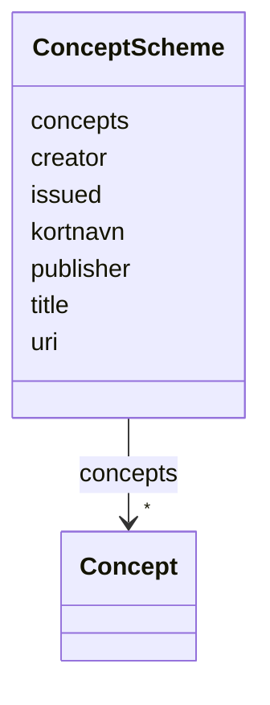

---
search:
  boost: 10.0
---

# Class: ConceptScheme 


_One vocabulary = one Excel workbook (vokabular sheet, rows 1-16)._


<div data-search-exclude markdown="1">


URI: [skos:ConceptScheme](http://www.w3.org/2004/02/skos/core#ConceptScheme)





<!-- no inheritance hierarchy -->

## Class Properties

| Property | Value |
| --- | --- |
| Class URI | [skos:ConceptScheme](http://www.w3.org/2004/02/skos/core#ConceptScheme) |
| Tree Root | Yes |


## Slots

| Name | Cardinality and Range | Description | Inheritance |
| ---  | --- | --- | --- |
| [uri](uri.md) | 1 <br/> [uri](uri.md) | Concept or scheme URI | direct |
| [kortnavn](kortnavn.md) | 1 <br/> [String](String.md) | Short name of the vocabulary, max 4 letters or digits (cell B12) | direct |
| [title](title.md) | 1 <br/> [String](String.md) |  | direct |
| [creator](creator.md) | 0..1 <br/> [String](String.md) |  | direct |
| [publisher](publisher.md) | 0..1 <br/> [String](String.md) | System-generated at publication | direct |
| [issued](issued.md) | 0..1 <br/> [Date](Date.md) | System-generated at publication | direct |
| [concepts](concepts.md) | * <br/> [Concept](Concept.md) | Container slot for the data file only | direct |


## Identifier and Mapping Information


### Schema Source


* from schema: http://example.org/vegvesen/vokabular/def/schema


## Mappings

| Mapping Type | Mapped Value |
| ---  | ---  |
| self | skos:ConceptScheme |
| native | svv:ConceptScheme |


## LinkML Source

<!-- TODO: investigate https://stackoverflow.com/questions/37606292/how-to-create-tabbed-code-blocks-in-mkdocs-or-sphinx -->

### Direct

<details>
```yaml
name: ConceptScheme
description: One vocabulary = one Excel workbook (vokabular sheet, rows 1-16).
from_schema: http://example.org/vegvesen/vokabular/def/schema
slots:
- uri
- kortnavn
- title
- creator
- publisher
- issued
- concepts
class_uri: skos:ConceptScheme
tree_root: true

```
</details>

### Induced

<details>
```yaml
name: ConceptScheme
description: One vocabulary = one Excel workbook (vokabular sheet, rows 1-16).
from_schema: http://example.org/vegvesen/vokabular/def/schema
attributes:
  uri:
    name: uri
    annotations:
      excel_column:
        tag: excel_column
        value: B
      excel_name:
        tag: excel_name
        value: begreps_URI
    description: Concept or scheme URI. For concepts built as <scheme URI>/<identifier>
      (v8 column B formula).
    from_schema: http://example.org/vegvesen/vokabular/def/schema
    rank: 1000
    identifier: true
    owner: ConceptScheme
    domain_of:
    - ConceptScheme
    - Concept
    range: uri
    required: true
  kortnavn:
    name: kortnavn
    annotations:
      excel_cell:
        tag: excel_cell
        value: B12
    description: Short name of the vocabulary, max 4 letters or digits (cell B12).
    from_schema: http://example.org/vegvesen/vokabular/def/schema
    rank: 1000
    slot_uri: svv:kortnavn
    owner: ConceptScheme
    domain_of:
    - ConceptScheme
    range: string
    required: true
    pattern: ^[A-Za-z0-9]{1,4}$
  title:
    name: title
    annotations:
      excel_cell:
        tag: excel_cell
        value: B13
    from_schema: http://example.org/vegvesen/vokabular/def/schema
    in_language: nb
    rank: 1000
    slot_uri: dct:title
    owner: ConceptScheme
    domain_of:
    - ConceptScheme
    range: string
    required: true
  creator:
    name: creator
    annotations:
      excel_cell:
        tag: excel_cell
        value: B14
    from_schema: http://example.org/vegvesen/vokabular/def/schema
    rank: 1000
    slot_uri: dct:creator
    owner: ConceptScheme
    domain_of:
    - ConceptScheme
    range: string
  publisher:
    name: publisher
    annotations:
      excel_cell:
        tag: excel_cell
        value: B15
    description: System-generated at publication.
    from_schema: http://example.org/vegvesen/vokabular/def/schema
    rank: 1000
    slot_uri: dct:publisher
    owner: ConceptScheme
    domain_of:
    - ConceptScheme
    range: string
  issued:
    name: issued
    annotations:
      excel_cell:
        tag: excel_cell
        value: B16
    description: System-generated at publication.
    from_schema: http://example.org/vegvesen/vokabular/def/schema
    rank: 1000
    slot_uri: dct:issued
    owner: ConceptScheme
    domain_of:
    - ConceptScheme
    range: date
  concepts:
    name: concepts
    annotations:
      rdf_skip:
        tag: rdf_skip
        value: true
    description: Container slot for the data file only. Not written to RDF; the RDF
      writer emits skos:inScheme on each concept instead.
    from_schema: http://example.org/vegvesen/vokabular/def/schema
    rank: 1000
    slot_uri: svv:concepts
    owner: ConceptScheme
    domain_of:
    - ConceptScheme
    range: Concept
    multivalued: true
    inlined: true
    inlined_as_list: true
class_uri: skos:ConceptScheme
tree_root: true

```
</details></div>